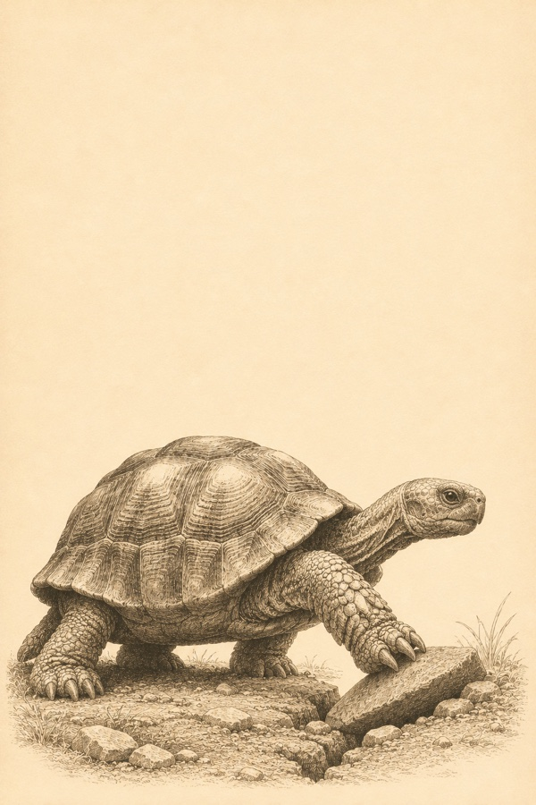

# Chapter III: The Intelligence Cycle

*The Tortoise: Judgment at Every Step*

> “He will win who knows when to fight and when not to fight.”
>
> **Sun Tzu, *The Art of War*, Chapter III**

A courier must reach the far bank before nightfall. The bridge is watched, the ferry is said to be under requisition, and a drover swears there is a ford upstream. By noon, the courier's companions have gathered three accounts of the ferry master's arrest, a sketch of the bridge and a rumour that the garrison is about to march.

They have yet to establish whether the ford will bear a laden horse.

The preceding chapters distinguished intelligence from information and examined the discipline by which it is acquired. This chapter concerns the work between a question and a decision. It begins by establishing what must be learned, proceeds through collection, processing, analysis and dissemination, and returns through feedback to the question itself. This is the intelligence cycle.

## 3.1 Requirements

Begin with the decision. The courier must choose a crossing by the afternoon bell, while there is still daylight to reach the upstream ford. “Discover what the garrison is doing” might occupy an agent for a month. “Which crossing can take a laden horse before nightfall, and where are travellers being stopped?” gives the same agent a task that can be completed or reported incomplete.

Divide the requirement where the answers call for different observations. The ford's depth and the presence of a patrol are separate questions. The drover may answer one from experience and know little of the other. Establish which uncertainties would alter the choice and when the answer must arrive. If the courier can travel on foot, that possibility should be known before anyone risks a source to find passage for a horse.

## 3.2 Collection

Choose the means by what they can establish and what they may cost. A watcher can count guards at the bridge from the market. A drover who crossed that morning can describe the ford as it was under his own horse. A notice at the landing can establish the terms of a requisition, if a notice has been posted.

Ask how a source came to know what he says. Three accounts of the ferry master's arrest may lead back to the same tavern keeper. The third retelling adds little to the first. A visit to the landing may establish more than another round of questions, provided someone can make it without drawing attention to the courier's business.

Give each collector a place, an interval and a condition for returning early. The watcher sent to count guards must know to send word at once if the bridge is closed.

## 3.3 Processing

Make the collected material fit for comparison. Mark where and when each observation was made. Identify names that refer to the same place. Copy a blurred entry carefully and mark the words that remain doubtful. Preserve the original account so that a disputed reading can be examined again.

The drover says he crossed at the old mill before the first bell with two sacks of meal on his horse. The watcher reports that the mill road was flooded at noon. On a clean sketch the mill road and the ford's approach turn out to be separate tracks. Set beside one another, the reports can now be compared. How much the river has risen in the intervening hours remains an open question.

Record the observation in terms that will survive a change of mind. “Two riders turned back at the bridge” can be used in several assessments. “The bridge was closed” conceals a judgment that the watcher may have made from only those two riders.

## 3.4 Analysis

Ask what the evidence supports, what else could account for it, and what observation would distinguish between the possibilities. The watcher sees laden carts admitted and two solitary riders turned back. The bridge is plainly open to some traffic. The guards may be looking for a particular rider, or they may be turning back all riders without papers. A third rider passing after showing a document would help establish what the courier might face.

At the ford, the drover's account gives good reason to believe a horse crossed in the morning. The flooded road gives reason to question whether that experience still holds. The assessment should carry both judgments. If the approach can be seen from high ground, a fresh observation there may be worth more than another witness to the morning crossing.

State how firmly each judgment is held and what could overturn it. A doubtful conclusion can still inform a decision when the person making it knows where the doubt lies.

## 3.5 Dissemination

Send the assessment to the person who must decide, in time and in a form that person can use. A courier ready to depart needs a short account of the crossings. The officer arranging tomorrow's passage may need the watcher's notes. Apply the discipline of compartmentalisation to both. The identity of the watcher should travel only where it is necessary to the work.

A dispatch might read:

> The bridge was open to carts at noon. Two lone riders were turned back, for reasons we could not establish. A laden horse crossed at the mill ford before the first bell. Water has since reached the mill road, and we have no later report from the ford. The ferry's availability remains unconfirmed.

That dispatch can go before the fresh observation arrives. Agree where a correction can reach the courier. A warning delivered to an empty room will be of interest chiefly to the person who sent it.

## 3.6 Feedback

Find out what happened to the assessment after it was sent. Did it reach the courier before departure? Could the courier act on it? Which uncertainty still mattered? An answer received at this stage may change the question while there is still time to act.

Suppose the courier can leave the horse and divide the load. The relevant question may now be whether the ferry takes foot passengers. A collector still measuring the ford for a horse is serving an expired requirement. Redirect the inquiry and release anyone whose work is finished.

After the crossing, compare the outcome with what was judged at the time. If the bridge patrol let the courier through because the guard knew him, a successful passage establishes little about how strangers would fare. Preserve the circumstance alongside the result.

The stages overlap in practice. A warning may leave while reports are still being compared, and an assessment may send a collector back to the river. Continue while the next answer could change the decision and is worth the time and exposure required to obtain it.

## 3.7 Principles for the Practitioner

1. **Begin with the decision.** Establish who must act and when.
2. **Give each inquiry a boundary.** Identify what would satisfy it and when it expires.
3. **Collect for a purpose.** Weigh what an observation could establish against the cost of acquiring it.
4. **Trace reports to their origins.** Repetition can give one witness the appearance of many.
5. **Preserve particulars.** Keep the original account, its time and its place.
6. **Separate observation from inference.** Let a later reader see where judgment entered.
7. **Test competing explanations.** Seek evidence that would help distinguish between them.
8. **Deliver warnings while they can be used.** State the uncertainty that accompanies them.
9. **Protect sources in the telling.** Give the recipient what is needed to act.
10. **Return to the requirement.** Revise it when circumstances change and close it when its purpose has been served.

---

## Closing Observation

At the edge of broken ground, a tortoise extends a forefoot and touches the stone ahead. If the stone shifts, its weight is still on the ground behind it. Once it has stepped, it must judge the next stone from where it now stands.

The operative does much the same. An assessment permits a decision. The decision changes the circumstances in which the next assessment must be made. Sometimes the whole advantage lies in learning that the stone has shifted while there is still time to put one's foot elsewhere.

---

**Next Chapter: Cover, Identity and Legend**

*The identities under which an operative goes about his business, and the histories by which those identities endure examination.*

---

[← Previous](./chapter-02-the-principles-of-tradecraft.md) · [Contents](./index.md) · [Next →](./chapter-04-cover-identity-and-legend.md)
