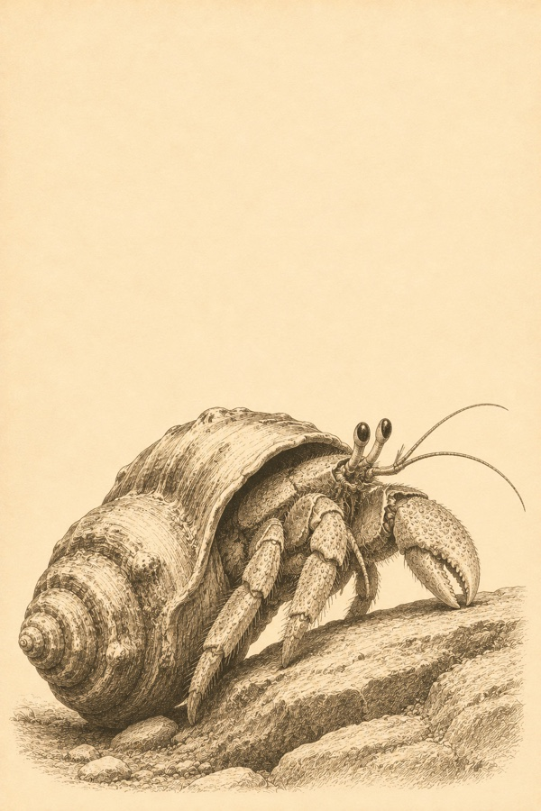

# Chapter IV: Cover, Identity and Legend

*The Hermit Crab: The Burden of a Borrowed Home*

> “The thane of Cawdor lives: why do you dress me\
> In borrow’d robes?”
>
> **[William Shakespeare, *Macbeth*, Act I, Scene 3](https://shakespeare.mit.edu/macbeth/macbeth.1.3.html#113)**

A warehouse keeper engages a cooper to repair damaged casks. The cooper arrives with tools, examines the work and agrees a price. Before the morning is over, the keeper has complained about three late consignments and named the carrier he holds responsible.

The cooper has learned something his patron wished to know. He has also undertaken to repair the casks.

By afternoon, the keeper will judge him on whether they hold water. A persuasive account of his apprenticeship will be of little assistance if they do not.

Chapter II described cover as the explanation by which others understand an operative's presence and activities. This chapter examines what it takes to inhabit that explanation. The work begins before an introduction and continues after the information has been obtained, for the people encountered will remember a person with business, habits and obligations of his own.

## 4.1 Identity, Cover and Legend

An identity is the person an operative presents himself as being: the name by which he is known, his claimed place in society and the relationships through which others recognise him. He may use his own identity while concealing the purpose of an assignment. An assumed name is one possible arrangement, not a requirement of the profession.

Cover explains his present business. In the warehouse, the cooper's employment accounts for his tools, his presence among the casks and his questions about when the next consignment is due. It does not account for an interest in the keeper's private correspondence.

A legend is the constructed history supporting an assumed role. It concerns such matters as where the cooper learned his craft, how he came to seek work here and who might remember him elsewhere. Parts of that history may be true. Every invented part creates a claim that another person may have reason to examine.

A disguise changes what an observer perceives. It can assist an assumed identity, but a changed face supplies neither a history nor a reason to be admitted. These distinctions matter whenever a plan relies upon one kind of preparation to accomplish the work of another.

## 4.2 Choose a Role That Can Be Lived

Begin with what the assignment requires and what the operative can actually do. Repairing casks may place someone near arriving goods. It will not necessarily place him near the person who orders them. Before undertaking the work, establish whether the role offers a reasonable opportunity to answer the question at hand.

Then consider the ordinary demands of the occupation. A cooper must work. A clerk may be asked to read an unfamiliar hand. A purported veteran may find himself discussing a campaign with someone who served in it. Clothing and confident speech cannot supply these abilities.

The operative who already practises a suitable trade has an advantage, though using his own livelihood brings its own exposure. Questions arising from the assignment may follow him home to his customers and family. A fabricated role can place different burdens upon those asked to support it. Neither arrangement is free of consequence.

Rank also carries costs. A claim to authority may secure an audience and provoke a request for credentials. A humble role may attract less ceremony while leaving its holder subject to searches, dismissal or demands he has little power to refuse. Choose with regard to the treatment the operative can expect to receive.

### A Reason for This Particular Action

The keeper knows why a cooper is in the warehouse. He may still ask why that cooper is beside the counting-room door. Carrying a damaged hoop there makes sense if the keeper has asked to see it; carrying the same hoop past the door six times creates a different impression.

An occupation explains only some of its holder's movements. Consider the immediate business as carefully as the wider role, including whether the person encountered can reasonably refuse the request. A plausible errand offers no entitlement to a private room.

## 4.3 A History Within Reach

A useful legend must remain within the operative's knowledge and capacity. Claiming apprenticeship under a famous master invites questions about that master's workshop. Claiming to come from a distant port may postpone those questions until a sailor from the port arrives.

Distance creates difficulties of verification, but it also makes the journey itself a subject of curiosity. In Qualihut, a long passage is an undertaking. Someone may ask about the road, the crossing, the delay or the companions who failed to arrive. An invented place of origin brings an invented journey with it.

Limit the history to what the role needs. This requires judgment about which particulars matter locally. The warehouse keeper may care chiefly about the cooper's previous work. A guild officer may care about the standing of his teacher. A fellow lodger may remember an offhand account of his family long after both have forgotten the circumstances in which it was told.

Nor should an operative borrow a living person's history as though it were an abandoned garment. That person has acquaintances, obligations and enemies. A claim made in his name may reach him, bring punishment upon him or interfere with business of which the operative knows nothing.

## 4.4 Who Will Accept the Account?

Identity is established differently in different places. A seal may satisfy one official. Another may want a local person to stand surety. In a small community, recognition by neighbours may carry more weight than a letter few people can read.

Discover what a particular witness can establish. The warehouse keeper who has watched the cooper work can attest to his skill and conduct over several days. He cannot thereby confirm a childhood in another province. A genuine letter of employment establishes what its author was prepared to put in writing; it need not establish every claim made by its bearer.

The same care applies to records. Surviving entries may be incomplete, mistaken or difficult to obtain. Their absence leaves uncertainty. It does not make an invented history safe, nor does a missing entry prove that an honest traveller is lying.

Reputation can travel through people when documents do not. A carrier remembers a debt. An apprentice recognises a former employer's name. A customer asks after a relative. None need suspect espionage to raise a question the operative cannot answer.

## 4.5 The Work Continues

Cover that lasts must accommodate days on which the assignment produces nothing. The casks still require attention. The keeper still expects the agreed work, and other labourers notice who contributes and who spends the morning asking questions.

This makes time and money part of preparation. Someone must pay for lodging, tools and food while the operative waits. Earnings should be understood in relation to the work being done. A patron who requires a convincing livelihood while allowing no time to practise it has given contradictory instructions.

Success can complicate the arrangement. The keeper may offer another week's employment or ask the cooper to teach an assistant. The operative now has an opportunity, an obligation and less freedom to leave. Refusing the offer may be entirely ordinary; accepting it alters what the assignment will require.

Observe how the role changes through use. A stranger hired for a morning can depart with little explanation. A trusted worker whose absence leaves others with unfinished business will be missed for reasons that have nothing to do with an adversary's vigilance.

## 4.6 Familiarity and Examination

The first encounter tests whether an account seems plausible. Continued association tests whether a person behaves consistently with it. A deliberate inquiry may test particulars against other witnesses. Preparation for one does not guarantee survival of the others.

Much of this examination occurs through ordinary company. People repeat anecdotes, compare experiences and introduce acquaintances. An operative may be accepted warmly and still find his account coming under closer scrutiny than it would at a gate.

Respond to the actual uncertainty. A question about the cooper's teacher may be friendly interest, professional rivalry or the beginning of an inquiry. Its meaning depends upon the surrounding conduct. The discipline of analysis applies here as elsewhere: distinguish what was asked from what one fears the question means.

When a role demands knowledge or authority the operative lacks, acknowledge the limit in planning. Some opportunities must be declined. Extending an identity to meet every unexpected demand eventually places it beyond what the operative can sustain.

### Recognition Beyond the Face

Suppose the keeper sees his cooper from behind, carrying a cask with the familiar pause before each step. He calls out before seeing the man's face. A different hat would have changed little.

An instructor may ask a pupil to describe a companion's posture, habitual gestures and handling of tools without mentioning his features. The exercise reveals how much recognition can survive a change of clothing. Attempting to suppress every familiar movement brings its own burden: the cooper must still lift the cask safely and perform the work he claims to know.

## 4.7 Magical Appearance and Social Recognition

An operative considering a magical disguise must establish what the particular effect changes, how long it lasts and what can interrupt or reveal it. Those are questions about the actual magic available. A reputation for powerful illusion is insufficient preparation.

Even an effect that produces the intended appearance leaves the work of recognition. The warehouse keeper knows how his cooper speaks about a damaged cask, what he promised yesterday and whether he has been paid. An altered face does not supply those memories. A familiar face may encourage expectations that its wearer cannot meet.

Repeated use also requires resources. A role that depends upon magic every working day must account for the means of sustaining it and the consequences when those means are unavailable. Finite supplies, expense and interruptions can determine whether such a role is practicable at all.

Magical examination belongs to the same careful assessment. Establish what a particular method can reveal and what remains a matter of inference. Neither the operative nor the examiner should assume that a spell supplies a complete account of a person's history or intentions.

## 4.8 The People Who Believe You

After several weeks, the warehouse keeper may recommend the cooper to a neighbour. A fellow worker may lend him money. The assistant may begin to depend upon his instruction. Their decisions have been made with incomplete knowledge of why he is there.

These relationships can become sincere. The concealment remains consequential. Affection does not establish that someone would accept the danger if he understood it, and useful cooperation does not establish consent to an intelligence undertaking.

A person who vouches for the operative may bear the cost of his disappearance or exposure. Consider that person's position before accepting the recommendation. Compartmentalisation limits what people know; it cannot prevent others from holding them responsible for what they did.

The operative also acquires commitments that his patron may never see. He may wish to finish teaching the assistant or remain until an injured colleague returns. These concerns belong in the assessment of the assignment. Concealing them from the person directing the work leaves that person making decisions upon an incomplete account.

## 4.9 Leaving the Role

Consider the end of an identity while deciding whether to assume it. Work concludes, employment changes and travellers depart. The particular role determines which endings are possible and what remains to be settled.

Returning borrowed tools and paying a lodging debt may spare others inconvenience and dispute. Such acts also require time. If danger forces an immediate departure, unfinished obligations remain with the people who trusted the operative. A departure can be necessary and still leave harm behind it.

An exposed identity cannot reliably be repaired by changing its name. People remember faces, work and associates; some may have reason to make inquiries. What has become known, and to whom, must be assessed before any further use of the role. The response to compromise is treated more fully in Chapter XXIV.

Even a quiet departure leaves memories. Months later, a carrier may recognise the cooper at another warehouse and greet him with pleasure. The assignment has ended. The acquaintance has not.

## 4.10 Principles for the Practitioner

1. **Know what the role explains.** Its limits matter as much as the access it offers.
2. **Choose work you can perform.** Ordinary competence will be tested after the introduction is over.
3. **Keep the history within reach.** Claims about training, origin and travel bring questions of their own.
4. **Distinguish kinds of support.** A witness to present conduct cannot necessarily attest to a distant past.
5. **Allow for daily life.** Employment, lodging and relationships consume time and resources.
6. **Reassess growing obligations.** An accepted role may become harder to leave as trust develops.
7. **Judge magic precisely.** Establish the effect's capabilities, costs and limits before relying upon it.
8. **Consider those who vouch for you.** Their confidence may expose them to consequences they never agreed to bear.
9. **Prepare for departure.** Identify what will remain unfinished and who will inherit it.
10. **Remember that recognition persists.** People may know the assumed identity long after its purpose has ended.

---

## Closing Observation

Imagine a hermit crab sheltering in a discarded shell. The shell protects it, but its opening and weight place limits upon how the creature can move. Taking shelter has changed the conditions of its life.

The operative who becomes a cooper acquires similar limits. By the end of the first week, he has promised repairs, accepted payment and become someone another worker expects to see in the morning. His account of himself now exists partly in other people's memories.

He may eventually put down the tools and leave. They must continue with the business in which he has taken a part.

---

**Next Chapter: Human Intelligence**

*What people know, why they choose to share it, and the obligations incurred by those who ask.*

---

[← Previous](./chapter-03-the-intelligence-cycle.md) · [Contents](./index.md) · [Next →](./chapter-05-human-intelligence.md)
