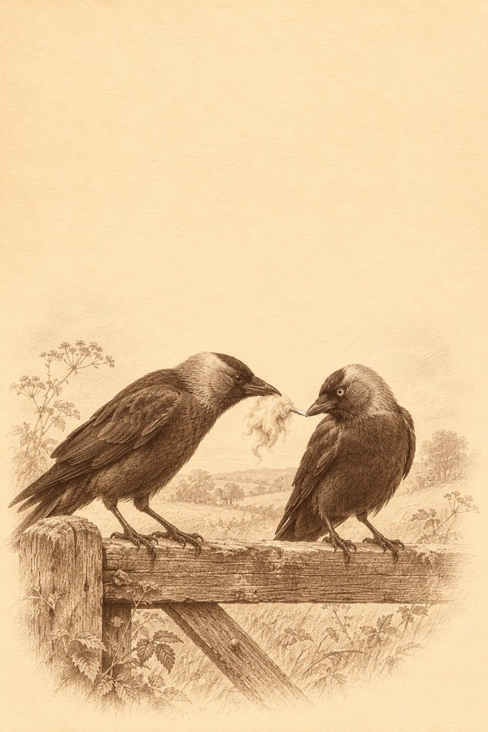

**Draft chapter.** Obtaining intelligence through people and relationships.

## An Invitation to Correct

A traveller remarks that the ferry must be idle until the harvest. The rope-maker replies that he has supplied it twice this week. An apparently casual correction has produced a useful lead.

Such a remark may be made deliberately to invite an answer. The reply still requires evaluation. The rope-maker knows what he supplied; he may know little of who is crossing. He may also exaggerate his business, repeat a rumour or recognise the invitation and supply an answer of his own choosing.

Preserve the circumstances in the report. A statement prompted by an assertion is not an unsolicited account, and the assertion may have suggested part of the reply. Repeating the exchange with several people may circulate the operative's own invention until it returns as supposed corroboration.

There is also a person left behind the conversation. The rope-maker may regret speaking when he learns why the ferry mattered. Information volunteered in ordinary company does not establish a willingness to become a source.

---

[← Previous](./chapter-04-cover-identity-and-legend.md) · [Contents](./index.md) · [Next →](./chapter-06-asset-development-and-recruitment.md)
