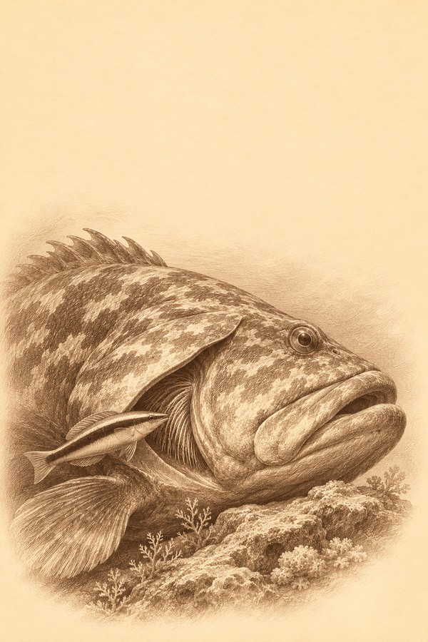

*The Cleaner Wrasse: Trust at the Gill*

> “The greatest trust, between man and man, is the trust of giving counsel.”
>
> **[Francis Bacon, *Of Counsel*](https://github.com/GITenberg/The-Essays-or-Counsels-Civil-and-Moral_575/blob/master/575.txt)**

**Draft chapter.** Identifying, cultivating, recruiting and maintaining intelligence assets.

---

[← Previous](./chapter-05-human-intelligence.md) · [Contents](./index.md) · [Next →](./chapter-07-signals-intelligence.md)
