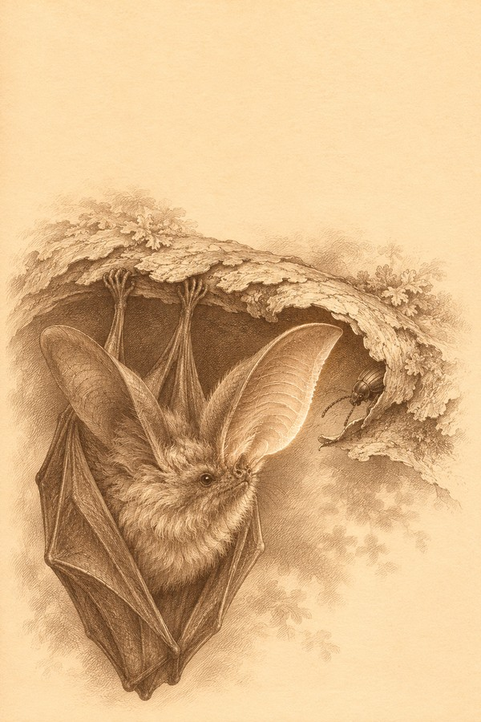

*The Long-Eared Bat: Hearing One Voice Among Many*

> “Be not afeard; the isle is full of noises,\
> Sounds and sweet airs, that give delight and hurt not.”
>
> **[William Shakespeare, *The Tempest*, Act III, Scene 2](https://shakespeare.mit.edu/tempest/tempest.3.2.html)**

**Draft chapter.** Communications interception and analysis.

---

[← Previous](./chapter-06-asset-development-and-recruitment.md) · [Contents](./index.md) · [Next →](./chapter-08-open-source-intelligence.md)
