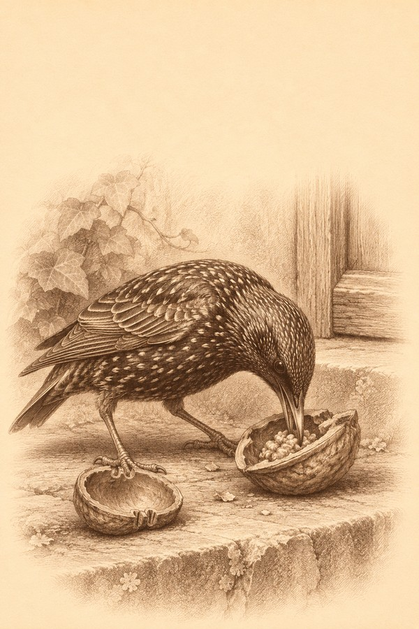

*The Starling: What the Doorstep Gives Away*

> “And this our life exempt from public haunt\
> Finds tongues in trees, books in the running brooks,\
> Sermons in stones and good in every thing.”
>
> **[William Shakespeare, *As You Like It*, Act II, Scene 1](https://shakespeare.mit.edu/asyoulikeit/asyoulikeit.2.1.html)**

**Draft chapter.** Deriving intelligence from publicly accessible information.

---

[← Previous](./chapter-07-signals-intelligence.md) · [Contents](./index.md) · [Next →](./chapter-09-imagery-and-geospatial-intelligence.md)
