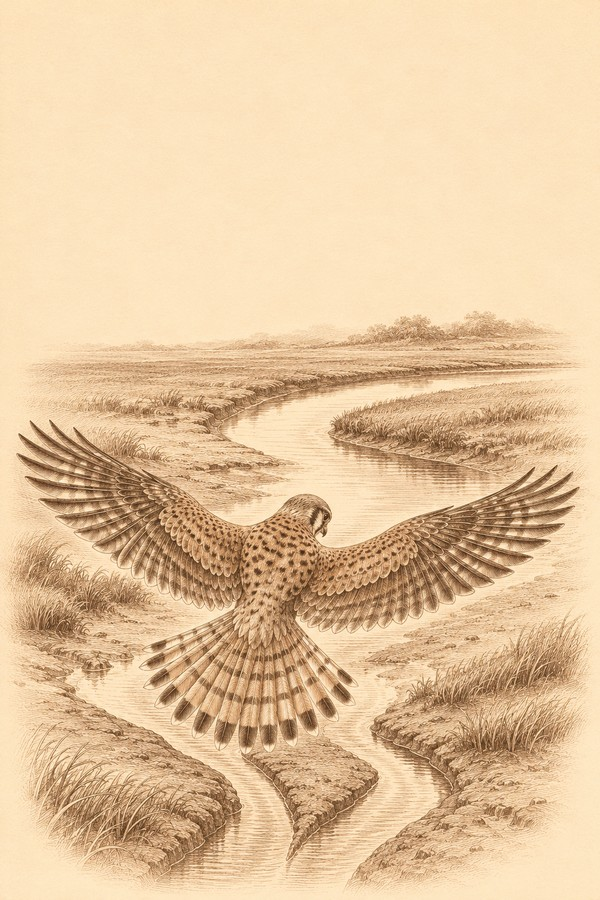

**Draft chapter.** Reconnaissance, maps, imagery and spatial analysis.

---

[← Previous](./chapter-08-open-source-intelligence.md) · [Contents](./index.md) · [Next →](./chapter-10-measurement-signature-and-technical-intelligence.md)
