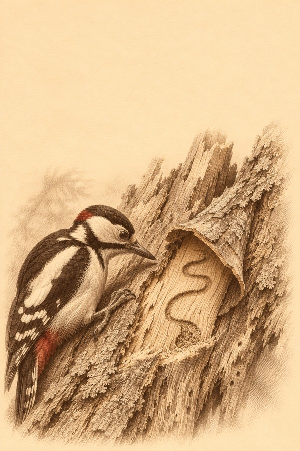

*The Woodpecker: A History Written in the Grain*

> “It has long been an axiom of mine that the little things are infinitely the most important.”
>
> **[Arthur Conan Doyle, *A Case of Identity*](https://github.com/GITenberg/The-Adventures-of-Sherlock-Holmes_1661/blob/master/1661.txt)**

**Draft chapter.** Physical signatures, alchemical traces and technical examination.

---

[← Previous](./chapter-09-imagery-and-geospatial-intelligence.md) · [Contents](./index.md) · [Next →](./chapter-11-magical-intelligence.md)
