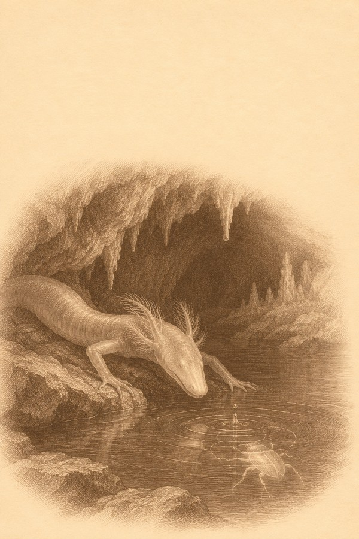

**Draft chapter.** Supernatural collection methods and their limitations.

---

[← Previous](./chapter-10-measurement-signature-and-technical-intelligence.md) · [Contents](./index.md) · [Next →](./chapter-12-surveillance-and-reconnaissance.md)
