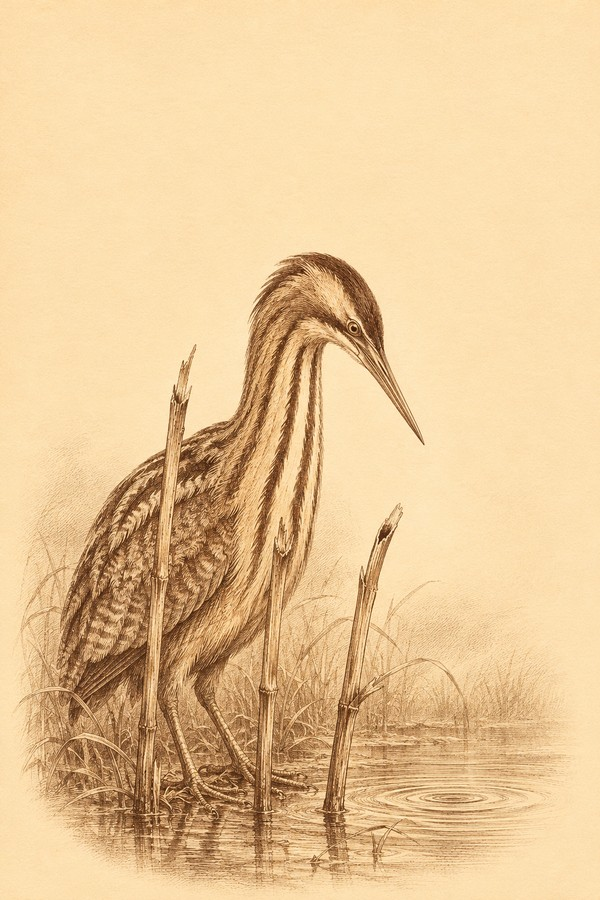

**Draft chapter.** Observation of individuals, locations and activities.

---

[← Previous](./chapter-11-magical-intelligence.md) · [Contents](./index.md) · [Next →](./chapter-13-clandestine-communications.md)
