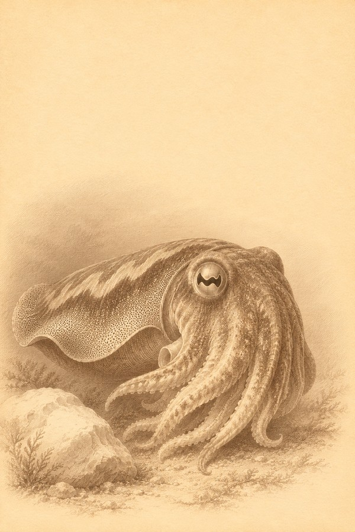

*The Cuttlefish: Who Can Read the Pattern?*

> “But, with the cipher now before us, all difficulty was removed by the signature.”
>
> **[Edgar Allan Poe, *The Gold-Bug*](https://www.eapoe.org/works/tales/goldbga2.htm)**

**Draft chapter.** Encryption, codebooks, keys and authentication.

---

[← Previous](./chapter-13-clandestine-communications.md) · [Contents](./index.md) · [Next →](./chapter-15-safe-houses-caches-and-logistics.md)
