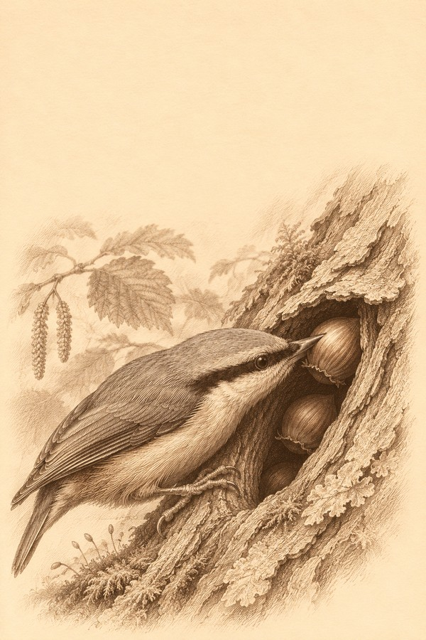

*The Nuthatch: A Summer’s Work Against the Winter*

> “The Ants were spending a fine winter’s day drying grain collected in the summertime.”
>
> **[Aesop, *The Ants and the Grasshopper*](https://github.com/GITenberg/Aesop-s-Fables--13-Translated-by-George-Fyler-Townsend_21/blob/master/21.txt)**

**Draft chapter.** Infrastructure and resources supporting clandestine activity.

---

[← Previous](./chapter-14-cryptography-codes-and-ciphers.md) · [Contents](./index.md) · [Next →](./chapter-16-operational-planning-and-execution.md)
