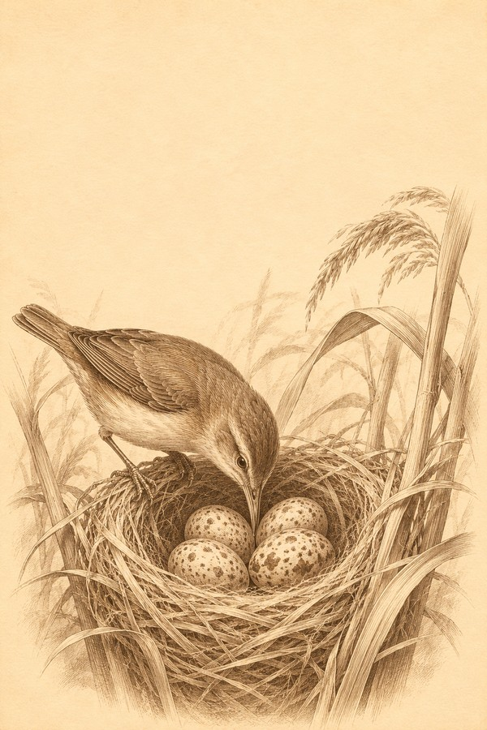

**Draft chapter.** Identifying hostile intelligence activity and compromised operations.

---

[← Previous](./chapter-16-operational-planning-and-execution.md) · [Contents](./index.md) · [Next →](./chapter-18-countersurveillance-and-evasion.md)
