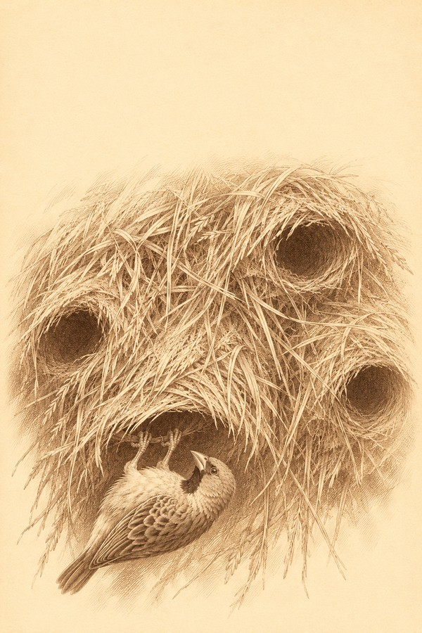

*The Sociable Weaver: Many Doors Under One Roof*

> “Union is strength.”
>
> **[Aesop, *The Lion and the Three Bulls*](https://github.com/GITenberg/Aesop-s-Fables--13-Translated-by-George-Fyler-Townsend_21/blob/master/21.txt)**

**Draft chapter.** Developing and organising contacts, assets and support infrastructure.

---

[← Previous](./chapter-20-magical-security-and-countermeasures.md) · [Contents](./index.md) · [Next →](./chapter-22-asset-handling-and-protection.md)
