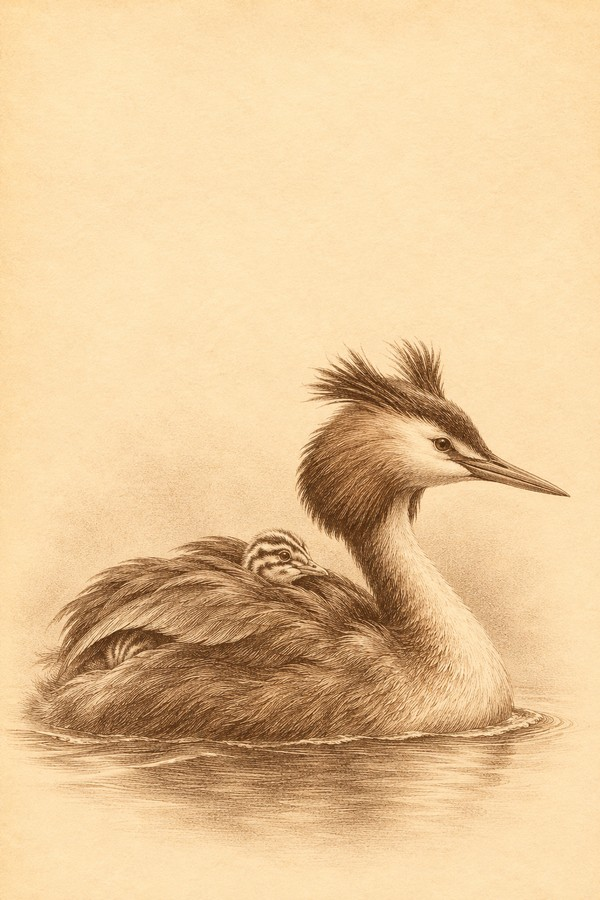

*The Crested Grebe: The Weight of Another Life*

> “O, I have ta’en\
> Too little care of this!”
>
> **[William Shakespeare, *King Lear*, Act III, Scene 4](https://shakespeare.mit.edu/lear/lear.3.4.html)**

**Draft chapter.** Maintaining relationships and protecting sources.

---

[← Previous](./chapter-21-building-a-clandestine-network.md) · [Contents](./index.md) · [Next →](./chapter-23-intelligence-analysis-and-source-evaluation.md)
