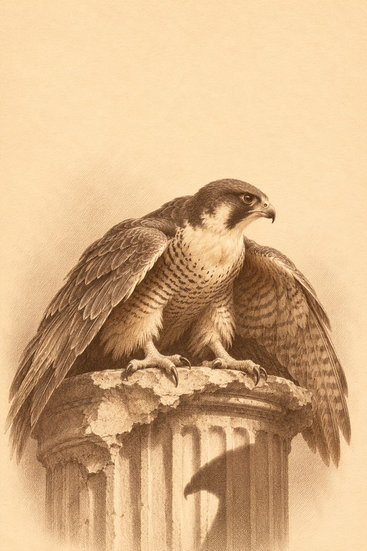

*The Peregrine: The Watcher Above the City*

> “the king is but a man, as I am: the violet smells to him as it doth to me”
>
> **[William Shakespeare, *Henry V*, Act IV, Scene 1](https://shakespeare.mit.edu/henryv/henryv.4.1.html)**

**Draft chapter.** Imperial doctrine and intelligence institutions.

See also [The Solar Church](../../institutions/solar-church.md).

---

[← Previous](./chapter-24-compromise-contingency-and-recovery.md) · [Contents](./index.md) · [Next →](./chapter-26-intelligence-in-the-union.md)
