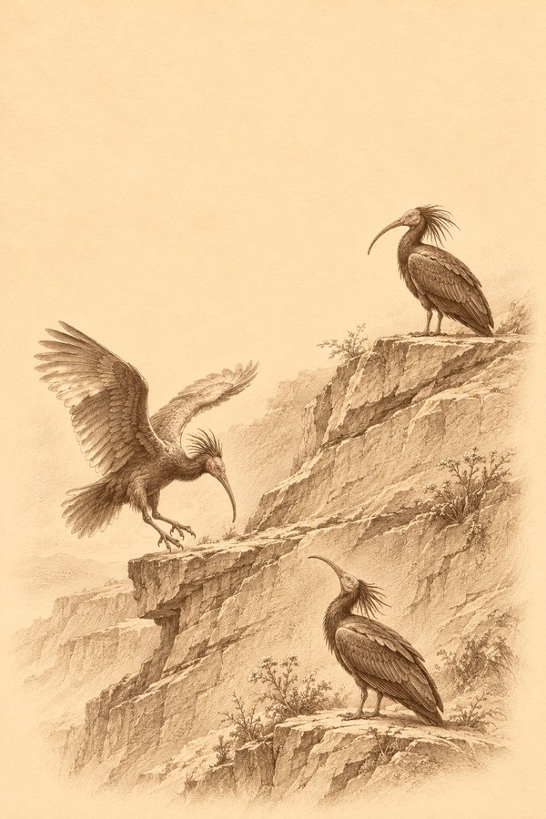

**Draft chapter.** Decentralised intelligence, insurgencies and information markets.

See also [The Southern Union](../../factions/southern-union.md).

---

[← Previous](./chapter-25-imperial-intelligence-and-the-solar-church.md) · [Contents](./index.md) · [Next →](./chapter-27-the-arcane-intelligence-contest.md)
