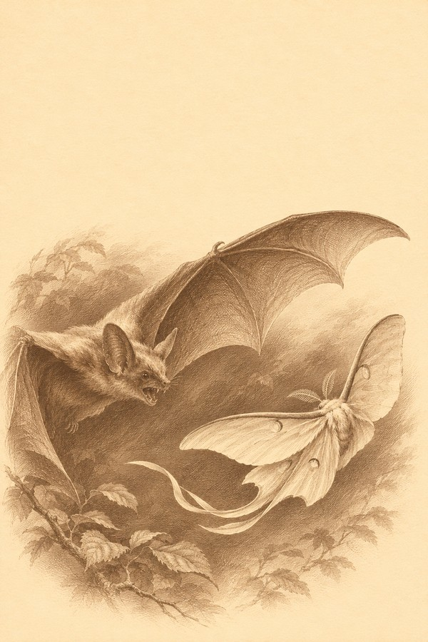

*The Moon Moth: The Price of Standing Still*

> “he that will not apply new remedies, must expect new evils”
>
> **[Francis Bacon, *Of Innovations*](https://github.com/GITenberg/The-Essays-or-Counsels-Civil-and-Moral_575/blob/master/575.txt)**

**Draft chapter.** Technological and magical developments in espionage.

---

[← Previous](./chapter-26-intelligence-in-the-union.md) · [Contents](./index.md) · [Next →](./chapter-28-the-ethics-of-the-invisible-trade.md)
